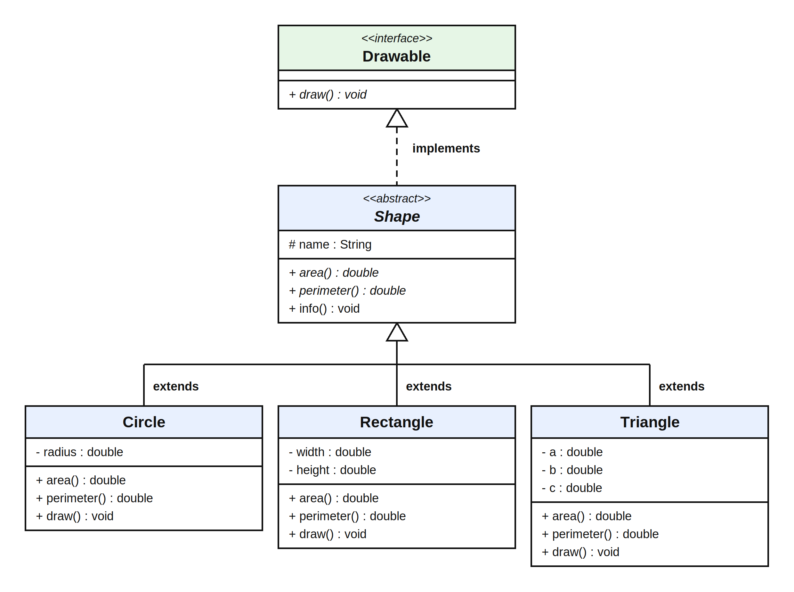

# Program Review

**Shape Management System**
Authors: `<Name 1> (<NIM 1>)`, `<Name 2> (<NIM 2>)` | Class: 5A

## 1. Interface

An interface is a contract that defines what a class must be able to do, without defining how. It is declared using the `interface` keyword, and classes use it through the `implements` keyword.

In the Shape Management System, `Drawable` is an interface that requires every drawable object to provide a `draw()` method.

```java
public interface Drawable {
    void draw();
}
```

The `Drawable` interface cannot be instantiated directly. It has no method body and stores no instance state. Any non-abstract class that implements it must write its own `draw()` method.

An interface describes a capability ("can be drawn"), and a class can implement more than one interface.

## 2. Abstract Class

An abstract class is a class declared using the `abstract` keyword. It provides a common structure for related classes and can contain abstract methods that must be implemented by its concrete subclasses.

In the Shape Management System, `Shape` is an abstract class that defines common attributes and methods for different shape types. It also implements the `Drawable` interface.

```java
public abstract class Shape implements Drawable {
    protected String name;

    public Shape(String name) {
        this.name = name;
    }

    public abstract double area();
    public abstract double perimeter();

    public void info() {
        System.out.printf("%s -> Area: %.2f, Perimeter: %.2f%n",
                name, area(), perimeter());
    }
}
```

The `Shape` class cannot be instantiated directly. Its subclasses must implement `area()` and `perimeter()`, because each shape uses a different formula. `Shape` does not write `draw()` itself. As an abstract class, it passes that duty from `Drawable` down to its subclasses.

Unlike an interface, an abstract class can hold fields (`name`), a constructor, and concrete methods (`info()`) that are inherited as they are.

## 3. Arrays

An array is a data structure that stores multiple elements of the same type in a fixed-size collection. It can store primitive values or references to objects.

In the Shape Management System, an array stores shape objects of different subclasses.

```java
Shape[] shapes = {
    new Circle(5),
    new Rectangle(4, 6),
    new Triangle(3, 4, 5)
};

for (Shape s : shapes) {
    s.draw();
    s.info();
}
```

The `shapes` array contains three objects. The array is declared with the parent type `Shape`, so it can hold `Circle`, `Rectangle`, and `Triangle` objects because all three classes inherit from `Shape`. The enhanced `for` loop accesses each element in turn.

An array has a fixed length after it is created.

## 4. Inheritance

Inheritance allows a class to acquire accessible attributes and methods from another class. In Java, it is implemented using the `extends` keyword for classes and the `implements` keyword for interfaces.

In the Shape Management System, `Circle`, `Rectangle`, and `Triangle` inherit from the abstract class `Shape`, and `Shape` implements `Drawable`.

```java
public class Circle extends Shape {
    private double radius;

    public Circle(double radius) {
        super("Circle");
        this.radius = radius;
    }
}
```

The `Circle` class inherits the `name` attribute and the `info()` method from `Shape`. The `super("Circle")` statement calls the parent class constructor to initialize `name`. Because `Shape` implements `Drawable`, a `Circle` is also a `Drawable`.

The `Rectangle` and `Triangle` classes follow the same inheritance relationship.

The `radius`, `width`, `height`, `a`, `b`, and `c` fields are `private`, so only their own class can access them (encapsulation). The `name` field is `protected`, so subclasses can read it directly.

Inheritance promotes code reuse and establishes a common structure for related shape classes.

## 5. Polymorphism

Polymorphism allows objects of different classes to provide different implementations of the same method. In Java, runtime polymorphism can be achieved through method overriding.

In the Shape Management System, `Circle`, `Rectangle`, and `Triangle` override `area()`, `perimeter()`, and `draw()` to apply their own formulas and behavior.

Circle:

```java
@Override
public double area() {
    return Math.PI * radius * radius;
}
```

The area of a circle is calculated using π × r².

Rectangle:

```java
@Override
public double area() {
    return width * height;
}
```

The area of a rectangle is calculated by multiplying width and height.

Triangle:

```java
@Override
public double area() {
    double s = perimeter() / 2;
    return Math.sqrt(s * (s - a) * (s - b) * (s - c));
}
```

The area of a triangle is calculated using Heron's formula.

Polymorphism is demonstrated when the program calls `draw()` and `info()` through a parent-class reference.

```java
for (Shape s : shapes) {
    s.draw();
    s.info();
}
```

Although the reference variable `s` has the type `Shape`, Java executes the overridden method corresponding to the actual object type. The `info()` method is written once in `Shape`, but it calls the `area()` and `perimeter()` of the real object.

For example, a circle with a radius of 5 has an area of 78.54 and a perimeter of 31.42. A rectangle of 4 × 6 has an area of 24.00 and a perimeter of 20.00. A triangle with sides 3, 4, and 5 has an area of 6.00 and a perimeter of 12.00.

This demonstrates how polymorphism allows different shape types to apply their own calculations through a common method, with no `if/else` needed to check the shape type.

## Conclusion

The Shape Management System demonstrates several Java programming concepts. Interfaces define a contract that classes must follow, abstract classes provide a common structure and shared code for shapes, arrays store elements in a fixed-size collection, and inheritance enables code reuse.

Finally, polymorphism allows different shape types to apply their own calculations and behavior through the shared `draw()`, `area()`, and `perimeter()` methods. Together, these concepts support a modular and extensible object-oriented application.

## Class Diagram



